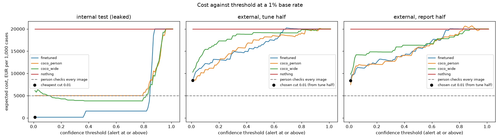

# **Fall detection for care-home night alerts**

**Name:** Allan Stalker **Student ID:** 19004 **Email:** [astalker.ieu2022@student.ie.edu](mailto:astalker.ieu2022@student.ie.edu)

 **Group:** BBADBA yr 5 group A

## **1. Business problem and the cost of being wrong**

The decision I am targeting for my project is a camera in a care home determining if a person has fallen. The scenario is the camera is in the resident's room and takes an image. My model decides whether to alert a nurse to go to the room to help the patient. This means my positive class in my model is Falling.

For my report, it is essential to understand that a missed fall does not cause the fall, it just is very costly if it is missed. The fall already happened and a missed fall delays help for the patient. So the cost of a false negative is the harm caused by that delay of a nurse due to model inaccuracy. A false positive means a nurse wasted her time doing a trip to the room and a resident who is woken up. Another issue that leads from positives is alarm fatigue, where staff start to ignore alerts because they happened so many times and never did anything, like the boy who cried wolf.

In my project the errors are nowhere near equal. I priced a false negative at €2,000 and a false alarm at €5, which is around 400 to 1. These numbers will be explained in section 6. Due to a miss costing so much more, I made three design choices for the model and project. Firstly, I choose falling as the positive class, and ensured that recall on falling matters far more than overall accuracy. Secondly, since a false alarm is so cheap compared to a miss, the best threshold should be low. Lastly, from what I discussed, adding a human in the loop is worth it, where a person checks the image on a screen before sending the nurse. A review is cheaper than a trip and can catch what the model misses.

## **2. Dataset**

I used the Roboflow dataset falldetection-bwfdz/fall-detection-ehgga, version 1 (CC BY 4.0, https://universe.roboflow.com/falldetection-bwfdz/fall-detection-ehgga/dataset/1). The dataset has three classes, Falling, Sitting and Standing, labelled with bounding boxes. Almost every image is a photo of a room with one person in it.

This dataset works for my problem because the posture(falling, sitting, standing) classes map directly onto the question "has this person fallen or not". It also makes the zero-shot baseline meaningful, because COCO already knows "person", so the off-the-shelf COCO model can find people without any prior training data.

One limitation of the dataset is that the images are staged. All the photos come from the same room with one or two actors, and the falls are acted out lying on a mat. Because of this issue, and because of the leakage problem in section 3, I tested on a second dataset that the model was never trained on. I used the ynt423/labels-6tnj1, version 1 (CC BY 4.0, https://universe.roboflow.com/ynt423/labels-6tnj1/dataset/1) data set, using test split only. I used this data set for testing and half of it for picking the threshold to decide when an image becomes a fall. The dataset has the same three classes.

## **3. What the data tells us**

**Table 1. Dataset composition and leakage check**

| | Train | Valid | Test | External test |
| ----- | ----- | ----- | ----- | ----- |
| Images (files) | 1,968 | 82 | 82 | 563 |
| Original photos | **656** | 82 | 82 | 506 |
| Falling instances | 540 | 32 | **27** | 109 |
| Sitting instances | 735 | 28 | 28 | 361 |
| Standing instances | 648 | 22 | 26 | 408 |
| Images with no person | 45 | 0 | 1 | 0 |
| Images with 2+ people | 0 | 0 | 0 | **186** |
| Median box size (share of image) | 16% | 15% | 16% | 9% |
| Images with a fall | | | 27 (33%) | 104 (18%) |
| Near-copies of train (hash within 10/256 bits) | | **74** | **76** | **0** |
| Median hash distance to nearest train image | | 4 | 4 | 96 |

Firstly, the training set is actually smaller than it looks because each photo appears three times with small changes so it goes from 1,968 files to only 656 original photos. These copies do help the model during the training part however, it does not add anything new rooms and people for the model to learn from which means the real size of the training set is 656 original photos.

Additionally, the test sets are both small. The internal test set has only 27 falls, so a single missed fall can affect recall by about 3.7 points. Similarly for the external half used for testing, has 52 falls, so one miss moves recall by about 2 points. 

Falls make up 33% of the internal test set and 18% of the external one, which does not reflect reality where in reality falls are to be assumed around 1% of the time. Precision and accuracy depend on how common falls are, so the values measured here do not hold in practice. For the cost I used recall and specificity as they do not depend on the base rate.

Despite all I mentioned, the biggest problem I found is data leakage with the majority of the test images (76 out of 82) and similarly with the validation (74 out of 82) are near copies of training images. This is because the photos were taken in bursts, so photos moments apart are in different splits(train and test). I found this flaw when I compared image hashes, where the median distance from a test image to its closest training image is just 4 bits out of 256. This is backed up by the training curves, with the validation for mAP50 was 0.92 after one epoch which would be suspiciously high without this data leakage.

This means I can't use the internal test set to determine that my model works well on new images. The near perfect score in this case only means that the model remembers the room and the actors.

In order to fix this flaw, I used an external set, as it fixes the overlap, having no near copies. I ran the check again and this time it had a median distance of 96. Must be noted that, this dataset is harder than the original data as it has smaller people(size seen in photo, 9% vs 16%), and 186 images with two or more people and very different types of images/backgrounds such as CCTV footage, sports photos, skating photos, and outdoors photos. However it does not have care home footage, so it tests generalisation of a fall, not the exact setting of a care home.

## **4. Finetuning and baselines**

For my model I finetuned a yolo11n, which is the nano version of YOLO11. I started from COCO-pretrained weights. I chose detection because the model has to find the person and judge their posture in one step, and the nano size is small and fast enough to run next to a camera.

For the training I ran it on Google Colab with the free T4 GPU they offer. I ran it for 50 epochs with these parameters: image size 640, batch 16, patience 10, seed 0. The total runtime of the training was 24 minutes. Early stopping (patience 10) would have stopped training if validation stopped improving for 10 epochs, but it never triggered, so all 50 epochs ran. The weights I saved and used for my model come from **epoch 42**. I chose these weights as it had the best validation score (mAP50 0.994, mAP50-95 0.854). For all my evaluation both internal and external, I used these same weights with no retraining.

For the scoring, I use the fact that the nurse acts on one image at a time, so I turned every system into one fall score per image. An image counts as a fall if anyone in it has fallen. For the finetuned model the score is the highest confidence of any falling box, and 0 if there is none. If there is just one confident fall box it is enough to send a nurse as not everyone in the image needs to fall, as one person in harm is enough danger. I compared my model against these three baselines:

* **COCO any person:** the off-the-shelf yolo11n alerts whenever it sees a person. This answers whether a normal people detector could be the alarm instead of a falling person.  
* **COCO wide box:** a person box wider than it is tall counts as a fall, because that means they are not standing or sitting. I fixed the cut off at 1.0 and never tuned it.  
* **Predict nothing:** never alert.

**Table 2. Finetuned model vs baselines (image level)**

| System | Internal recall | Internal spec. | External recall | External spec. | Internal € / 1,000 | External € / 1,000 |
| ----- | ----- | ----- | ----- | ----- | ----- | ----- |
| Finetuned | 100% | 98% | 43% | 67% | 140 | 8,348 |
| COCO any person | 100% | 0% | 53% | 28% | 5,000 | **7,445** |
| COCO wide box | 85% | 80% | 21% | 95% | 3,816 | 9,796 |
| Predict nothing | 0% | 100% | 0% | 100% | 20,000 | 20,000 |

In this test, recall and specificity are at a threshold of 0.25. Costs use each system’s best threshold from the sweep, at a 1% base rate. For the external set, the threshold is chosen on one half and the cost is reported on the other half of the dataset, more info in section 6. The Internal test set confusion matrix for the finetuned model at 0.25 gave the following results: TP 27, FP 1, FN 0, TN 54.

On the internal test set the finetuned model clearly beats both baselines which as previously mentioned is not a fair assessment. On the external set it is a different story. At the threshold of 0.25 it catches 43% of falls, fewer than COCO any person at 53%, and on cost COCO any person is cheaper on its own. My model does beat the COCO wide box and predict nothing baseline, but not COCO any person. So on the external set my model does not beat both baselines. My understanding of why it does not beat COCO any person is that the model learned what a fall looks like in that one room, not what a fall looks like in general.

Predicting nothing also shows why accuracy is the wrong metric. It scores 67% accuracy internally and 81.5% externally while catching zero falls. 

## **5. Evaluation per class and failure modes**

**Table 3. Per-class box metrics, internal vs external**

| Class | Internal P | Internal R | Internal AP50 | External P | External R | External AP50 |
| ----- | ----- | ----- | ----- | ----- | ----- | ----- |
| **Falling** | 1.000 | 0.961 | 0.995 | 0.139 | 0.303 | 0.101 |
| Sitting | 0.982 | 1.000 | 0.995 | 0.119 | 0.003 | 0.007 |
| Standing | 0.981 | 1.000 | 0.995 | 0.172 | 0.039 | 0.019 |
| **mAP50 / mAP50-95** | 0.995 / 0.850 | | | 0.042 / 0.015 | | |

As explained before, for my project falling is the positive class. As explained by previous limitations, the internal test for every class is near perfect, but because of the data leakage not generalisable for the real world. The box confusion matrix (as shown below) shows a few falling and standing swaps and some extra boxes in the empty background, but the good thing is that no person is missed. At image level the model catches all 27 falls with only one false alarm. 

**Internal test (finetuned model, boxes)**

| Predicted ↓ / True → | Falling | Sitting | Standing | background |
| :---- | :---- | :---- | :---- | :---- |
| **Falling** | **24** | 0 | 4 | 13 |
| **Sitting** | 0 | **28** | 0 | 1 |
| **Standing** | 3 | 0 | **22** | 5 |
| **background** | 0 | 0 | 0 | **0** |

**External test (finetuned model, boxes)**

| Predicted ↓ / True → | Falling | Sitting | Standing | background |
| :---- | :---- | :---- | :---- | :---- |
| **Falling** | **40** | 71 | 22 | 952 |
| **Sitting** | 5 | **12** | 12 | 777 |
| **Standing** | 19 | 60 | **31** | 542 |
| **background** | 45 | 218 | 343 | **0** |

In the matrices above, rows are what the model predicted and columns are true values. The background column in this case, is boxes drawn on empty space, and the background row is people the model missed.

On the external set mAP50 is where the results took a hit and drop from **0.995 down to 0.042**. The failures I have identified:

* **People are not found at all.** From the external confusion matrix, the model missed 343 of 408 standing people. Not only that but also missed 218 of 361 sitting people and crucially missed 45 of 109 fallen people. The issue is clear, the model is not seeing people.  
* **Finding falls in empty space.** The model drew 952 falling boxes where there was no one actually there causing a lot of false alarms.  
* **Sitting called Falling.** One of the biggest mix ups is that 71 people who were sat were labelled Falling. For the model, a low sitting posture can seem like someone on the floor.  
* **A thin margin even internally.** The model’s margins were tiny with the weakest real falls scored at 0.368 and 0.377 while the most fall-like non-fall scored 0.366. Even with the fact of leaked data the gap between fall and not fall was super small.

My explanation to these failures is because of the training overfitting to one setting. The model only ever saw one room, one or two actors and falls that happened on the same mat. When the model was shown external data, the people were smaller (9% of the image vs 16%), sometimes in groups and in completely different backgrounds. Not only that but the external set has things like sports falls, which look nothing like a resident falling. This shows that the two datasets do not fully agree on what a fall is. From my understanding this points to my model learning the room rather than the posture of a fall.

## **6. Cost matrix and operating point**

Below is a table explaining the cost of each of the model output and under the table there are explanations of where the numbers are derived from.  
**Table 4. Cost of each outcome**

| Outcome | Cost | What it means |
| ----- | ----- | ----- |
| TP | €5 | Nurse goes to the room and finds the fall |
| FP | €5 | Nurse goes to the room for nothing |
| FN | €2,000 | Resident stays on the floor until the next round |
| TN | €0 | No fall and no trip |

**False positive (€5).** I based this number on the nurse's pay. The Rioja Salud 2025 pay table states that they make €30,043 a year. However it must be accounted that the 32% employer social security is a cost as well and this ends up being around €39,700, social security is a cost as well. Finally, I divide the amount by the total time worked per year. It is around 1,770 hours (the Madrid and Galicia care home agreements give 1,772 and 1,762). The final number is €22 an hour. The duration of a check is about 10 minutes and that cost is €3.75. I decided to round up to €5 in order to cover walking to the resident and interrupting other work they were focused on before the check. It must be noted that private care homes potentially pay more or less, so this estimate is derived from public pay tables.

**True positive (€5).** A true positive costs the same as a false alarm because it is the same trip. The benefit of catching a fall is the €2,000 avoided, so I do not count it twice.

**False negative (€2,000).** This is my judgement and the least defended number in the report as it is very variable depending on the initial state of the patient if they have other illnesses, their age, all factors apply to vary this number. With that said, lying on the floor for over an hour is strongly linked to a serious injury. This would lead to potentially hospital admission and moving into long term care (Fleming & Brayne, 2008). With that in mind, my number comes from the estimate that a hip fracture in Spain costs about €9,936 to 12,000. Also used is this US data stating that 2 to 6% of care home falls cause a fracture. Taking about 4% of €10,000 gives €400 for fractures alone. Additionally, a UK study of older people who fell found that half of those who lay on the floor for more than an hour died within six months (Wild, Nayak & Isaacs, BMJ 1981). With this in mind I raised it to €2,000 to cover the harm of a long lie that could involve a fatal accident. I want to note once more this is the weakest number in the project.

**Base rate (1%).** This number represents how often an image shows a fall. From data I got from Spanish care home residents, it mentions they fall about 1.5 times a year (Zaragoza study, the US figure is 1.7). I assume a motion or person trigger only sends the model an image when something happens in the room. If each bed sends about 150 images a year (about 0.4 a night), then 1.5 falls out of 150 images gives a 1% base rate. This assumes the trigger never misses a fall, but I do not have a source for it.

With these numbers it is worth alerting whenever the chance of a fall is above 5 / 2,000 = **0.25%**. That is a very low bar, so I expect a low threshold. My 1% base rate is four times this break-even, so even an image the model knows nothing about is worth checking because it is a person's life.

**Choosing the threshold.** I swept all the possible threshold values from 0.01 to 1.01 in increments of 0.01 and picked the one with the lowest cost. To avoid picking and reporting on the same images, I split the external set in two (stratified, seed 0). The threshold is chosen on the tune half and the cost is reported on the report half. The internal set is not used because of the leakage.

**Table 5. Cost at each system’s best threshold (€ per 1,000, 1% base rate)**

| System | Internal (leaked) | External report half | Recall | Specificity | TP | FP | FN | TN |
| ----- | ----- | ----- | ----- | ----- | ----- | ----- | ----- | ----- |
| Finetuned (threshold 0.01) | 140 | 8,348 | 73.1% | 40.9% | 38 | 136 | 14 | 94 |
| COCO any person | 5,000 | 7,445 | 84.6% | 12.6% | 44 | 201 | 8 | 29 |
| COCO wide box | 3,816 | 9,796 | 53.8% | 89.1% | 28 | 25 | 24 | 205 |
| Predict nothing | 20,000 | 20,000 | 0% | 100% | 0 | 0 | 52 | 230 |
| Nurse walks to every image | 5,000 | **5,000** | 100% | 0% | 52 | 230 | 0 | 0 |

Costs are € per 1,000 images at a 1% base rate. Recall, specificity and counts are on the external report half (52 falls, 230 non-falls) at each system’s best threshold, chosen on the tune half.

**Figure 1. Cost against threshold at a 1% base rate**

The right panel (external report half) is the honest result. The black dot is the threshold chosen on the tune half (0.01), and the dashed line is the nurse walking to every image (€5,000).

Looking at the costs, the tuned half gave €8,426 and the report half €8,348, so therefore we can see that the threshold held up on images it had not seen with the cost not changing drastically. The chosen threshold of 0.01 is the lowest one, which means on new images the cheapest option is to alert any falling box. Even then the model costs more than COCO any person and more than having the nurse walk to every image.

If I were to change the assumptions, what would happen to the results? To answer that I reran the sweep with different costs and base rates, choosing the threshold on the tune half each time. First case is that if the FN cost is less than €500, or if the base rate is 0.25% or less, the COCO wide box becomes the cheapest single option. With new numbers again, putting the FN cost at €1,000 or more, or a base rate of 0.5% or more, the nurse walking to every image is cheapest. In the end, my finetuned model is never the cheapest single threshold option on external data. That is why section 7 adds human in the loop.

Some weak spots which must be noted are that some of my sources are not strong. The base rate comes from a student thesis, the working hours came from a blog, and the fracture rates from US data over Spanish data. The long lie death rate statistic was not for people at care homes but people living at home, which means longer wait times for help and less specialised assistance in most cases. Moreover, many Spanish care homes have care assistants rather than nurses on site at night, which reduces the salaries making a trip cheaper and pushes the threshold even lower.

## **7. What a person still has to check**

In my eyes the model alone is not good enough. On new test sets, it costs more than the COCO baseline that just alerts on any person it finds, and more than sending the nurse to every image. So I added a human in the loop. Instead of a singular threshold, an image goes one of three ways:

* **Pass:** no alert and nobody looks at it.  
* **Review:** a staff member looks at the image on a screen and decides whether to send the nurse. I assume this takes about 60 seconds and costs €0.40, and that the reviewer catches 95% of falls and correctly clears 99% of non-falls. These come from my class notebook and were not measured.  
* **Nurse:** the nurse goes straight to the room.

I set the review line at 0, so nothing is passed without someone seeing it. The reason is that the model gives no falling box at all to about 27% of external falls, so if I set this above 0 it lets real falls go unseen. From what I just said, it may seem as if my model is useless if every image is checked. However, it is useful to determine whether the checks should be done by the staff or go straight to the nurse. The nurse line is 0.34, picked by the sweep on the tune half. This means any instance with the Falling score above 0.34 goes straight to the nurse, which saves time.

I also set a rule that no more than 75% of images go to review. I decided on the 75% cap because in most care homes the person watching the screen also does rounds. This means that they cannot sit in front of the screen all night. This cap also ensures that the clearest cases go straight to the nurse, so the residents get help faster without waiting for a review. The cap was set on the tune half, which is why we see the report half slightly above at 78%.

On the report half (the external images not used to choose the lines), this design costs €2,110 per 1,000, catches 97% of falls and sends 78% of images to review. Additionally of the total 52 falls, none of them were passed without review. The split was that 33 went to review and 19 went straight to the nurse. Taking into account the 230 non falls, none were passed(by design), 180 went to review and 50 went to the nurse.

**Table 6. My design vs the alternatives**

| Design | € / 1,000 | Falls caught | Screen checks / night | Nurse trips / night |
| ----- | ----- | ----- | ----- | ----- |
| Do nothing | 20,000 | 0% | 0 | 0 |
| Model alone (cut 0.01) | 8,348 | 73% | 0 | 24.4 |
| Nurse walks to every image | 5,000 | 100% | 0 | 41.1 |
| Staff review every image | 1,497 | 95% | 41 | 0.8 |
| **My design (cap 75%)** | **2,110** | **97%** | **32** | **9.6** |

**Table 7. Price of the review cap**

| Cap | Nurse line | € / 1,000 | Reviewed | Falls caught | Trips / night |
| ----- | ----- | ----- | ----- | ----- | ----- |
| 100% | 0.78 | 1,517 | 100% | 95% | 1.0 |
| 90% | 0.59 | 1,715 | 91% | 96% | 4.3 |
| 80% | 0.42 | 1,933 | 83% | 97% | 7.6 |
| **75%** | **0.34** | **2,110** | **78%** | **97%** | **9.6** |
| 70% | 0.30 | 2,248 | 74% | 97% | 11.3 |
| 60% | 0.15 | 2,857 | 59% | 98% | 17.4 |
| 50% | 0.03 | 3,310 | 45% | 98% | 22.9 |

Although the cap is nice, it does come at a cost of about €600 per 1,000 more than reviewing everything would cost and adds about 9 extra nurse trips a night. The upside is that in return it catches 2 more points of falls and gets the nurse to the clearest cases straight away. I think that is worth it in a real care home. My cost model does not put a price on speed, so this is a judgement rather than something the numbers prove. If a staff member could watch the screen full time, reviewing everything would be cheaper.

Finally, do I think this is realistic? A 100-bed home at a 1% base rate gets about 41 images a night (100 beds x 150 / 365). My design means about 32 screen checks (about 32 minutes) and about 10 nurse trips (about 96 minutes) a night. One existing night staff member can handle that, so no extra people are needed. It breaks down if the camera sends a snapshot every minute instead of on a trigger, as that would be thousands of images a night.

**Reviewer sensitivity.** With the cap fixed at 75%:

* If reviewers recall 99% gives €1,604, 95% gives €2,110, 90% gives €2,743, 80% gives €4,034 and 70% gives €4,771.  
* If Review cost €0.20 gives €1,954, €0.40 gives €2,110, €1.00 gives €2,579 and €2.00 gives €3,360.

The result depends far more on how accurate the reviewer is than on what a review costs. Moving reviewer recall from 99% to 70% raises the cost by about €3,200, while a tenfold rise in review cost (€0.20 to €2.00) adds only about €1,400. Even with a weak reviewer (70%) the design still just beats sending the nurse every time (€5,000), but not by as much. Since reviewer accuracy is an assumption, it is the number most worth measuring.

## **8. Limitations and next steps**

Below is a bullet point list of all the limitations of the project and next steps to improve it. 

* **Firstly was the leaked internal splits.** I was unable to use the dataset's own test set because internal numbers are not trustworthy. They were too similar to the train split because of the bursting of photos and similar scenes with the same people. To fix this I would need to get a new dataset which has varied people and rooms also for test and train splits to be different types of photos, not the same person in the same room.  
* **The model does not generalise to new scenes.** Currently the model does not work well on new data, the COCO model was better when it predicted all humans. To improve, the model needs varied training data. This could be combining several fall datasets, and best case scenario is real care home footage collected, obviously with consent.  
* **Reviewer accuracy is assumed.** This assumption drives my final costs predictions more than anything else. To measure this I would mix known falls into the reviewer’s queue and check how many they catch.  
* **FN cost and base rate are estimates.** If I had access to care home incident records this would allow me to have a better understanding of FN cost, and a small pilot in the care home would show the real trigger rate rather than guessing.  
* **The external set is not care home footage.** Finding care home fall data was a challenge so for the external test set, it contained sports falls and stock photos. As mentioned above, having real care home footage would help. This would help for testing as images from different homes would mean something the training data has not seen.   
* **Small test counts.** For testing I only had 27 internal and 52 external falls per half (external data). This was not enough for precise recall as one mistake moves these numbers a lot. As mentioned above more fall images are needed.  
* **Privacy.** For improvements I mentioned the need for realistic photos however cameras in residents' rooms raise GDPR and consent questions that would need to be solved before any real deployment.

Despite all the issues mentioned in the project, this is a project which could do a lot of good for society and save lives so I worked through it despite its flaws because I think it can make meaningful change with the right model, dataset and execution.

## **9. AI disclosure**

Throughout this project I used AI (Claude) to support me with coding, analysis and understanding concepts. Firstly, AI helped me find and compare datasets and generated most of the code for the notebook and the Gradio application. Additionally, I used AI to run different analyses, debug errors. However, the main decisions regarding the project, such as the problem, the dataset, the baselines, the case definition and fall score, the costs and base rate, how to handle the leakage, the external test set, the tune/report split were made by me. I came to it with an idea and vision and had it execute the vision. Additionally, sometimes I would ask the AI what are the different options and pros and cons then I would decide which route to take. Regarding the report, AI helped me with the structure, but I wrote and reviewed the analysis myself. Overall, I would frame my use of AI as an execution tool. I have the idea, the decisions and AI would be here to help me build the project and improve my understanding.

## **References**

* Massachusetts DPH falls data brief: https://www.mass.gov/doc/data-brief-trends-in-fall-related-injury-among-nursing-home-residents-in-massachusetts-2018-2022/download  
* CDC nursing-home falls fact sheet (archived): https://webharvest.gov/peth04/20041018164544/http:/www.cdc.gov/ncipc/factsheets/nursing.htm  
* Fleming & Brayne, BMJ 2008: https://www.bmj.com/content/337/bmj.a2227.abstract  
* Rioja Salud 2025 pay tables: https://riojasalud.es/files/content/rrhh/tablas-retributivas/TABLAS%20SALARIALES%20LABORALES%2016-01-2025.pdf  
* 2025 Spanish contribution rates (Asepeyo): https://asepeyo.es/wp-content/uploads/Bases-tipos-cotizacion-2025-Asepeyo-ES.pdf  
* Hip fracture cost in Spain (review): https://www.redalyc.org/pdf/3609/360933657001.pdf  
* Basque hip fracture protocol: https://www.euskadi.eus/informacion/publicaciones/web01-s2oga/es/adjuntos/Protocolo56FracturaCadera.pdf  
* Zaragoza care-home falls study: https://zaguan.unizar.es/record/10586/files/TAZ-TFG-2013-131.pdf  
* SEMERGEN Córdoba study: https://www.elsevier.es/es-revista-medicina-familia-semergen-40-congresos-41-congreso-nacional-semergen-105-sesion-atencion-personas-con-patologias-cronicas-5726-comunicacion-caidas-en-mayores-capaces-que-67201-pdf  
* Care-home working hours summary: https://turnozo.com/es/blog/convenio-residencias-privadas-madrid  
* Wild, D., Nayak, U.S.L. & Isaacs, B. (1981). How dangerous are falls in old people at home? BMJ: https://pmc.ncbi.nlm.nih.gov/articles/PMC1504022
